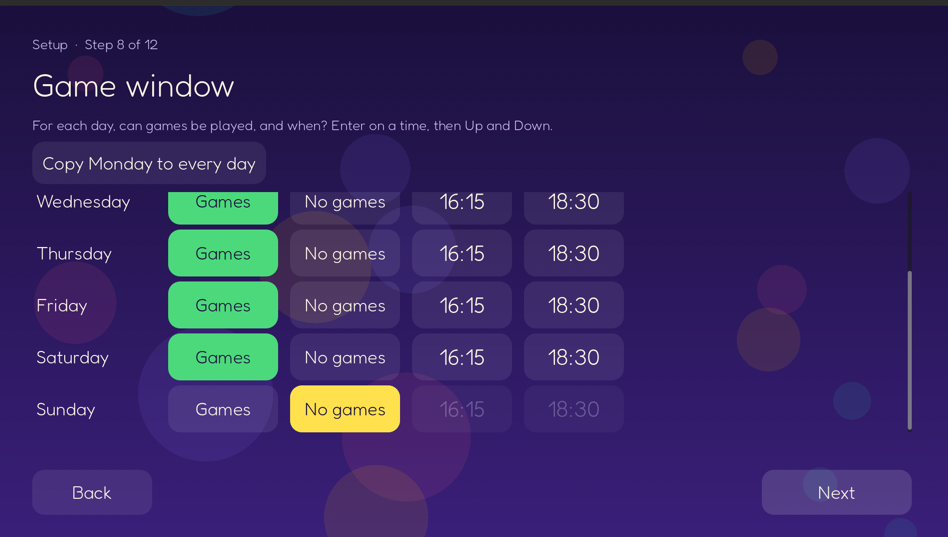
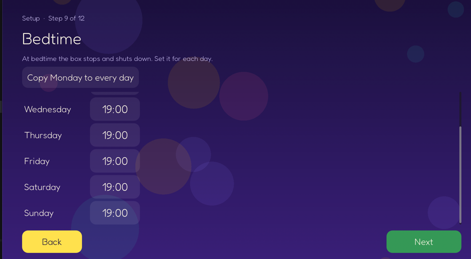

# Kids TV Box: design doc CORRECTIONS

## Status (2026-10-24)

| Item | Status | Next step |
|---|---|---|
| Next button in the setup | Done, key test in the repo | Try it on the VM |
| Guide table in the admin app | Done | Try it on the VM |
| Copy from USB on the box | Done | Try it on the VM with a real USB drive |
| Music: artists, songs, shuffle, search, playlists | Done | Try it on the VM (playback not tried: no mpv on the build machine) |
| Loose ends | Done in da-box, except 3 (kept as it was) | See the last section |

### Try the finished work on the VM

1. `vm/box-vm.sh deploy`
2. Reset the box settings to see the setup again (back up `/var/lib/dabox`, as before).
3. On the TV: go through the setup with the keyboard only. Check Game window and Bedtime: the jump to Next, Down to Next, Left/Right between Back and Next, Up back to the table.
4. In the admin app (http://localhost:8081): Guide tab. Check the channel picker, the week picker, Shuffle week, Shuffle day, Fill again, a click on a programme, a click on an empty place.
5. Copy from USB: make a disk image with `Films/`, `TV/`, `Music/` and `Games/` folders, turn on parent mode in the admin app, `vm/box-vm.sh usb-in stick.img`. On the TV: the USB tile on Home, tick a folder, open a folder and tick one item, Copy, leave the progress screen (the bar on Home), the message at the end. Pull the stick during a copy (`vm/box-vm.sh usb-out`): the copy stops with "USB removed", and no half item is left.
6. Music on the TV: the menu row, "+" on a song and on Now playing, a new playlist named with the keyboard, Rename, Delete (press two times), "−" on a song. In the admin app: Content tab, Playlists.

## Next button difficult to select in the UI
This screen it is very hard to figure out how to get to the next button without a mouse. 
It seems you have to be on the bottom right of the table, press down, then press right.

In fact if you have selected "No games" on Sunday it seems impossible to even click "Next" 
Solution:
1. If the user populates all days the selector should move automatically to the next button.
2. Alternatively if the user presses down when the selector is on the last row of the table, it should move to the next button (this should already exist).
3. When the selector is on "Back" or "Next" left and right switch between them, up moves back to the mon-sun table.

Status: **done**, not yet tried on the VM. It works for every setup step (`ui/scripts/screens/setup_screen.gd`, `ui/scripts/widgets/value_picker.gd`).
- When a change sets the last empty day of a table step (Game window, Bedtime, also with "Copy Monday to every day"), the selector goes to Next. It does this only one time. A later change in the step does not jump.
- Down from the bottom of a step goes to Next. If Next is not active yet, it goes to Back.
- On Back or Next: Left and Right move between them. Up goes back to the control used last in the step.
- While a time is being changed, Down still changes the time.
- Tested with a scratch Godot test that presses the arrow keys (13 checks pass). There is no test for this in the repo yet.

This screen is similar. It seems impossible to use arrows to select "Next"

Same solution as above

## Admin app 

### Guide

Generate again should randomly generate the schedule. There should also be buttons to do this for each day. 

The view should also be better and not one long vertical list. It should be a table with days as columns and time slots as rows. Clicking a cell lets you add content

Decisions:
- One table for each channel. A channel picker at the top selects the channel.
- A programme's height in the table shows its length.
- "Shuffle day" changes only that day. The rest of the week stays.
- Shuffle changes only the channel that shows.

Spec:

1. **Top of the tab:** channel picker, week picker (Previous week, This week, Next week, and the dates of the week), and the week button (see 5 and 6).
2. **The table:**
   - 7 columns, Monday to Sunday, with the date. Today is marked.
   - A time column on the left with the hours. The table starts at the channel's earliest opening time in that week and ends at its latest closing time.
   - Each programme is a block. Its top is its start time. Its height is its length.
   - A block shows the start time, the title and the subtitle (episode or artist). A programme the parent changed has a "changed" mark. A gap the parent emptied shows as "Empty".
   - Closed hours are grey.
   - The time scale grows so that the shortest programme of the week can still be read and clicked (music tracks, short episodes). It has a limit, so a very short programme can still be small.
   - On a phone the table scrolls sideways. The time column stays on the left.
3. **Click a block:** a dialog with "Change" (pick another programme, it starts at the same time), "Empty" and "Undo" (only for a changed block). These are the actions of today's list.
4. **Click an empty place in a day:** the same dialog opens, to add a programme. It starts at the time you clicked (rounded down to 5 minutes). Programmes that the box filled in and that are under it make way. Programmes you changed or emptied never move.
5. **Shuffle (shuffle channels):** "Shuffle week" at the top, and "Shuffle day" at the top of each day column. Each press gives a new random order. Programmes you changed or emptied stay.
6. **In-order channels:** they always play in order, so there is no shuffle. There is one "Fill again" button for the week. It fills the week again (for example after new files) in the same order.
7. A shuffle is saved with the week. When the box fills the week again by itself (after a channel change, "Fill again" or "Undo"), the week and day shuffles stay. "Shuffle week" gives the whole week a new order, also the days that had their own shuffle.

Status: **done**, not yet tried on the VM.
- Service: `service/dabox/channels.py` saves the shuffles with the week (`ChannelShuffle`) and fills the week day by day. A day with its own shuffle gets its own random order. The week's order still deals through that day, so the other days do not change.
- API (`service/dabox/guide_api.py`): `GET /api/admin/guide/week?channel_id=&day=` (one channel, one week) and `POST /api/admin/guide/shuffle` (`channel_id`, `day`, `whole_week`). `POST /api/admin/guide/slots` takes a time with no time zone as the box's local time. `POST /api/admin/guide/generate` is "Fill again".
- Admin app (`service/dabox/admin_web/`): the week table. The Guide tab is wider (up to 1200 px) than the other tabs, so all 7 days show on a computer.
- Scale: from 1.6 to 12 pixels per minute, so that the shortest programme of the week is about 24 px high.
- Tests: 8 new service tests (161 pass). Checked in a browser against a dev service: shuffle day, add at a clicked time, empty, music channel, phone layout, week picker.

### Upload

Uploading one file at a time from the admin app takes too long for a hard drive full of content.
Today the box can only copy one film or one album from a USB drive at a time, and only from the admin app.

Solution: copy a USB drive to the box in one go, **on the box (the TV UI), not in the admin app**.

1. The user plugs the USB drive into the box. The drive uses the normal folder layout (`Films/`, `TV/`, `Music/`, `Games/`).
2. On the box, the user opens "Copy from USB" and sees the folders on the drive.
3. The user **ticks the folders** to copy.
4. **Before the copy starts,** the box adds up the size of the ticked folders and checks the free space on the box. If there is not enough space, the box tells the user (how much is needed, how much is free) and does not start.
5. The copy runs in the background. The box shows the progress.
6. When the copy is done, the box scans the files and fetches art and details.

Also: TV shows and games get the single-item "Copy to the box" action. Today only films and albums have it.
``
Decisions:
- "Copy from USB" shows on the box **only in parent mode**.
- The user ticks **at two levels**: tick a top folder (`Films`, `TV`, `Music`, `Games`) to copy all of it, or open it and tick single films, shows, albums or games.
- An item that is already on the box is **skipped**.
- The single-item "Copy to the box" action for TV shows and games is **on the box**.
- The box **can be used** (watch, listen, play) while the copy runs in the background.

Status: **done** (2026-10-24), not yet tried on the VM.
- Service: `service/dabox/usb_copy.py` (tree, space check, copy job) and `service/dabox/usb_copy_api.py`: `GET /box/usb/tree`, `POST /box/usb/check`, `POST /box/usb/copy`, `POST /box/usb/copy/stop` and `POST /box/content/{id}/copy-to-box` need parent mode; `GET /box/usb/copy` (progress) does not. `service/dabox/copying.py` now copies films, albums, games and shows the same way for the job and the admin app.
- A show that is on the box in part gets only its missing episodes. The space check keeps 500 MB free for the box itself.
- The job scans the library before it reports "done", so new items are there when the TV says so.
- Box UI: USB tile on Home (parent mode), `copy_usb_screen.gd` (tick list), `copy_progress_screen.gd`, the bar on Home, a message at the end (also on mpv's screen through the agent). "Copy to the box" on a USB film or game (Play / Copy to the box in parent mode) and on a USB album. A single TV show is copied from the tick list: the box has no TV show screen.
- Added: "Stop copying" on the progress screen (parent mode).
- Tests: 9 service tests (`tests/test_usb_copy.py`), key tests for the tick list. Tried with the dev service and a test stick in `dev/usb`.

Plan, service:
1. **Read the drive:** an API that lists a USB drive as a tree: top folders (`Films`, `TV`, `Music`, `Games`), then the films, shows, albums and games in each, with the size of each. It marks the items that are already on the box.
2. **Space check:** an API that adds up the size of the ticked items (without the ones already on the box) and compares it with the free space on the box. If it does not fit, it says how much is needed and how much is free, and the copy does not start.
3. **Copy job:** one background job at a time. It copies item by item into the box media folder. It skips items that are already on the box. It uses the same `.partial` then rename method as `service/dabox/copying.py`, so a pulled drive leaves no half item.
4. **Progress:** an API with the job state: items done, items left, bytes done, bytes in total, the item now, skipped items, errors.
5. **When the job ends:** scan the library and fetch art and details (as after an upload).
6. **Single item copy:** extend `copy_to_box` to TV shows and games. Game saves stay, because the fingerprint comes from the file's content (`file_fingerprint` in `service/dabox/library.py`).
7. Only in parent mode: the box API refuses these calls when parent mode is off.

Plan, box UI (Godot):
1. "Copy from USB" screen: the tick list at two levels (tick a top folder, or open it and tick items). Items already on the box show as "On the box" and cannot be ticked.
2. A "Copy" button. It runs the space check first and shows the result.
3. A progress screen. The user can leave it (the copy goes on), and come back to it.
4. "Copy to the box" on a TV show and on a game (and on films and albums, if the answer to question 3 below is yes).

Plan, tests: service tests for the tree, the space check, skip, the job and parent mode. A Godot test for the tick list keys.

Answers (2026-10-24):
1. **Where is "Copy from USB" on the box?** A Home tile that shows only in parent mode.
2. **Where does the progress show** when the user leaves the progress screen? A small progress bar on Home while the copy runs, and a message on the TV when it ends.
3. **Films and albums:** "Copy to the box" goes on the box for films, albums and games, and stays in the admin app.
4. **The drive is pulled out during a copy:** the job stops, the half item is removed, and the TV says "USB removed. Copied X of Y. Plug it in again to finish." The items already copied are skipped next time.
5. **Parent mode is switched off during a copy:** the copy goes on. Parent mode is needed only to start a copy.
6. **Upload tab in the admin app:** stays as it is.

## Music

Today the Music screen shows only albums. There is no search, no artists, no songs, no shuffle and no playlists.
DESIGN.md asks for "Albums, artists, shuffle and Now playing". Artists and shuffle are missing.

Solution: add all of these to the Music screen on the box.

1. **Artists.** A list of artists. Pick an artist to see their albums.
2. **Songs.** A list of all songs, A to Z. Pick a song to play it.
3. **Shuffle.** Shuffle one album, or shuffle all music.
4. **Search.** Use the on-screen keyboard to find an artist, an album or a song.
5. **Playlists.** A playlist is a list of songs, in an order, with a name.

Decisions:
- The user moves between Albums, Artists, Songs, Playlists and Search with a **menu**.
- **Both** the parent (in the admin app) and the kids (on the box) can make playlists.
- Playlists hold **only songs on the box**. A song on a USB drive must be copied to the box first.
- Search shows artists, albums and songs in **one result list**.
- Shuffle all does **not** include music from a USB drive.

Status: **done** (2026-10-24), not yet tried on the VM.
- Service: `service/dabox/music.py`, `service/dabox/playlists.py`, `service/dabox/music_api.py`. Box: `GET /box/music/artists`, `/songs`, `/search?q=`, `/shuffle[?album_id=]`, `/box/music/albums?artist=`, playlists. Admin: `/api/admin/music/songs` and playlists (also `PUT .../songs` for the order).
- Playlists are saved in the box store. A deleted song is left out, and dropped from the playlist at its next change. Shuffle all plays up to 500 songs (mpv gets them all on its command line).
- The agent passes a song id through, so Now playing knows which box song plays.
- Box UI: the menu row on `music_screen.gd`, `artist_screen.gd`, `playlist_screen.gd`, `add_to_playlist_screen.gd`, `name_screen.gd`, `search_screen.gd`, "Shuffle" on the album screen, "+" on Now playing. Admin app: Playlists card on the Content tab.
- Tests: 11 service tests (`tests/test_music.py`), key tests for the menu. Tried with the dev service, except playback (no mpv on the build machine).

Plan, service:
1. **Artists:** an API with all artists (from box and USB albums), and the albums of one artist.
2. **Songs:** an API with all songs, A to Z.
3. **Search:** an API that takes text and gives one list of artists, albums and songs.
4. **Shuffle:** shuffle one album; shuffle all music on the box (not USB).
5. **Playlists:** saved in the box store. Create, rename, delete, add a song, remove a song, change the order. Only songs on the box.
6. Hidden items stay hidden in all of these (as in the album list today).

Plan, box UI (Godot):
1. A menu on the Music screen: Albums, Artists, Songs, Playlists, Search.
2. Artists screen, Songs screen, Playlists screen, one playlist screen.
3. Search screen with the on-screen keyboard (`ui/scripts/widgets/on_screen_keyboard.gd`) and one result list.
4. "Shuffle" on the album screen, and "Shuffle all music".
5. Make a playlist and add songs on the box.

Plan, admin app: Playlists: make, rename, delete, add and remove songs, change the order.

Plan, tests: service tests for each API. A Godot test for the menu keys.

Answers (2026-10-24):
1. **Where is the menu?** A row of buttons at the top of the Music screen.
2. **Kids' playlists:** a kid can change (rename, delete, add and remove songs) only the playlists made on the box. The parent (admin app, or the box in parent mode) can change or delete every playlist.
3. **How a kid adds a song:** both, from the song list and from Now playing.
4. **Naming a playlist on the box:** with the on-screen keyboard, up to 30 characters. No limit on the number of playlists.
5. **A song on a playlist is deleted or hidden:** a deleted song goes away from the playlist. A hidden song stays on it but is skipped in kid mode, so it comes back when it is shown again.
6. **Where is "Shuffle all music"?** In the menu row, as its own button.

## Loose ends

In da-box (2026-10-24):
1. **Godot key tests: done.** `ui/tests/key_tests.tscn` (run: `godot --headless --path ui res://tests/key_tests.tscn`): the setup Next button, the Copy from USB tick list, the Music menu and the new screens. It found one more setup bug, now fixed: Right on Back went into the table when Next was not ready.
2. **Old admin guide API: removed.** `GET /api/admin/guide` is gone; the test uses the week API. "Fill again" returns nothing now (the admin app did not use the answer).
3. **Emptying or placing a slot does not fill the rest of the week again:** kept as it was.
4. **Dev test media: done.** 20 minute films, 7 to 11 minute episodes, 2 to 4 minute songs (about 420 MB, under 2 minutes to make). Delete `dev/media` to make it again.
5. **`img_2.png` and `.idea/`:** `.idea/` is in `.gitignore`. `img_2.png` was only on the Mac.
6. **Found on the way:** `ui/scripts/main.gd` failed when a screen came back and the control that had focus was gone; fixed.

Outside da-box (this Mac):
1. **pre-push check for work hosts** was not added (the permission check stopped the edit).
2. **Lock files from the work registry:** `betsys-shop/package-lock.json` and `js-playground/package-lock.json`.
3. **`PYTHONPATH`** in `~/.zshrc` adds two work folders for every shell.
4. **`~/.Trash/python-playground-2026-10-23`**: empty the Trash when you are sure.
